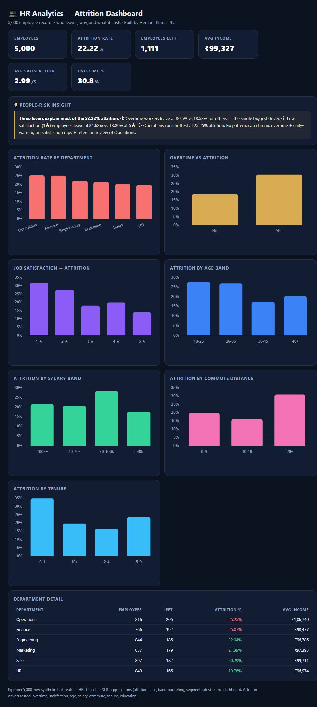

# 👥 HR Analytics — Attrition Dashboard

**Business question:** *Who is leaving, why are they leaving, and what should HR fix first?*



## ▸ Project Highlights

▸
Profiled attrition across 5,000 employee records — 1,111 exits (22.22% attrition rate) tested against 8 risk dimensions.
▸
Isolated overtime as the single biggest driver — employees working overtime leave at 30.5% vs 18.53% for others.
▸
Quantified the satisfaction cliff — 1★-satisfaction employees exit at 31.68% vs 13.89% at 5★, an 18-point spread HR can monitor monthly.
▸
Surfaced two quiet drivers — long commutes (20+ km → 30.94% attrition vs 19.68% at 0-9 km) and first-year churn (34.8% for tenure 0-1), and pinpointed Operations (25.25%) as the hottest department.

## 📁 Repo Structure

```
├── data/
│   ├── data.csv          # 5,000 employee records (synthetic, deterministic)
│   └── data.db           # SQLite database
├── sql/
│   └── queries.sql       # 10 annotated queries incl. risk ranking
└── dashboard/
    ├── index.html        # Interactive dashboard (Chart.js)
    ├── agg_data.json
    └── screenshot.jpg
```

## 🚀 How to Run

1. **Dashboard:** open `dashboard/index.html` in any browser.
2. **SQL:** `sqlite3 data/data.db < sql/queries.sql`

## 🔍 Key SQL (the composite risk cohort)

```sql
SELECT COUNT(*) employees,
       SUM(CASE WHEN attrition='Yes' THEN 1 ELSE 0 END) exits,
       ROUND(100.0*SUM(CASE WHEN attrition='Yes' THEN 1 ELSE 0 END)/COUNT(*),2) attrition_rate
FROM employees
WHERE overtime='Yes' AND job_satisfaction <= 2 AND distance_from_home >= 20;
```

## 💡 Analytical Takeaways

1. **Overtime is a retention cost, not a productivity win** — a 12-point attrition gap means chronic overtime teams should be a monthly review item, not a badge of honour.
2. **Satisfaction dips are early-warning signals** — the 1★→5★ spread (31.68% vs 13.89%) makes pulse-survey scoring a leading indicator worth tracking before exit interviews.
3. **Fix the first year** — 34.8% of exits happen in tenure 0-1; onboarding and early compensation reviews target the largest single leak.
4. **Commute is fixable policy** — a 30.94% attrition rate for 20+ km commuters justifies hybrid/remote options as a retention lever, not just a perk.

---

*Dataset is synthetic and generated deterministically for portfolio demonstration. All figures are computed from the data via the SQL in `sql/queries.sql`.*

**Built by Hemant Kumar Jha** · Data Analyst · SQL · Python · Dashboards
